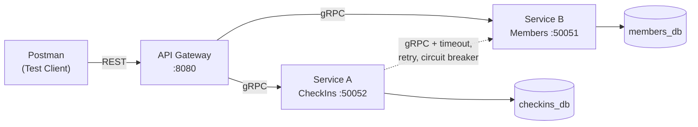

# WEB303 — Microservices Assignment: Gym Check-In System

A two-service microservices application built in **Go** demonstrating:

- **Bounded contexts** and the **Database per Service** pattern
- **API Gateway** (REST in, gRPC out)
- **gRPC** communication with **Protocol Buffers**
- **Resilience patterns**: timeout, retry with exponential backoff, circuit breaker
- **Multi-stage Dockerfiles** and **Docker Compose** orchestration

## Architecture



**Flow:** Postman calls only the API Gateway. The gateway forwards to both services over gRPC. Service A calls Service B over gRPC with resilience patterns applied. Each service reads/writes only its own database.

## Domain

- **Service B — Members** owns the independent resource `Member`. A member has a name, email, phone, and plan (basic / premium / vip).
- **Service A — CheckIns** owns the dependent resource `CheckIn`. Every check-in **must reference an existing member**, verified by calling Service B over gRPC.

Each service has its **own PostgreSQL database**. Service A cannot read Service B's tables — it can only talk to it via gRPC.

## Repository Layout

```
.
├── proto/                     # Shared .proto files + generated Go code
│   ├── members.proto
│   ├── checkins.proto
│   ├── members/v1/            # Generated: members.pb.go, members_grpc.pb.go
│   └── checkins/v1/           # Generated: checkins.pb.go, checkins_grpc.pb.go
├── service-b-members/         # Service B (Go + Postgres)
│   ├── main.go
│   ├── sql/schema.sql
│   ├── internal/{config,db,handler}
│   └── Dockerfile
├── service-a-checkins/        # Service A (Go + Postgres + resilient client)
│   ├── main.go
│   ├── sql/schema.sql
│   ├── internal/{config,client,db,handler}
│   └── Dockerfile
├── api-gateway/               # REST → gRPC gateway
│   ├── main.go
│   ├── internal/{clients,config,handlers,httpjson,statusmap}
│   └── Dockerfile
├── postman/                   # Exported Postman collection
├── docker-compose.yml
├── .env.example
└── README.md
```

## Quick Start

**Prerequisites:** Docker + Docker Compose.

```bash
# 1. Clone
git clone https://github.com/SangayZin/web303-assignment.git
cd web303-assignment

# 2. Configure environment
cp .env.example .env

# 3. Bring everything up
docker compose up --build
```

The API is available at `http://localhost:8080`.

## API Endpoints

### Members (Service B)

| Method | Path | Description |
|--------|------|-------------|
| `POST` | `/members` | Create a member |
| `GET` | `/members` | List members |
| `GET` | `/members/{id}` | Get a member |
| `PUT` | `/members/{id}` | Update a member |
| `DELETE` | `/members/{id}` | Delete a member |

### Check-Ins (Service A)

| Method | Path | Description |
|--------|------|-------------|
| `POST` | `/checkins` | Create a check-in (verifies member exists via gRPC) |
| `GET` | `/checkins` | List check-ins (`?member_id=` optional filter) |
| `GET` | `/checkins/{id}` | Get a check-in |
| `PUT` | `/checkins/{id}` | Update check-in notes |
| `DELETE` | `/checkins/{id}` | Delete a check-in |

### Example Requests

```bash
# Create a member
curl -X POST http://localhost:8080/members \
  -H 'Content-Type: application/json' \
  -d '{"name":"Alice","email":"alice@example.com","phone":"1234567890","plan":"premium"}'

# Create a check-in (replace <member-id>)
curl -X POST http://localhost:8080/checkins \
  -H 'Content-Type: application/json' \
  -d '{"member_id":"<member-id>","notes":"Morning session"}'
```

## Resilience (Service A → Service B)

Service A wraps its gRPC calls to Service B with three patterns:

1. **Per-call timeout** — each attempt has a deadline (default 2s). Prevents hanging.
2. **Retry with exponential backoff** — up to 3 attempts with 100ms → 1s backoff. Retries only on transient codes (`Unavailable`, `DeadlineExceeded`, etc.). Never retries on `NotFound` or `InvalidArgument`.
3. **Circuit breaker** — trips open after 3+ requests with ≥60% failures. While open, calls fail fast with a meaningful `Unavailable` error.

**Fallback:** If Service B is down, the gateway returns **HTTP 503** with a clear message instead of hanging.

Demonstration:
```bash
docker compose stop service-b-members
curl -X POST http://localhost:8080/checkins \
  -H 'Content-Type: application/json' \
  -d '{"member_id":"any","notes":"test"}'
# → 503 Service Unavailable  (after ~2s)
docker compose start service-b-members
```

## Configuration

All configuration comes from environment variables (see `.env.example`). Nothing is hard-coded.

| Variable | Default | Purpose |
|----------|---------|---------|
| `HTTP_PORT` | `8080` | Gateway listening port |
| `GRPC_PORT` | `50051` / `50052` | Service ports |
| `DB_HOST`, `DB_PORT`, `DB_USER`, `DB_PASSWORD`, `DB_NAME` | — | Postgres connection |
| `MEMBERS_ADDR` | `service-b-members:50051` | Service A → B target |
| `MEMBERS_TIMEOUT` | `2s` | Per-attempt gRPC deadline |
| `MEMBERS_MAX_ATTEMPTS` | `3` | Retry attempts |
| `CB_FAILURE_RATE` | `0.6` | Circuit breaker trip threshold |

## Testing

Import `postman/WEB303_Assignment.postman_collection.json` into Postman.

Test order:
1. Create a member → capture `id`
2. Get / update the member
3. Create a check-in with the member `id`
4. Try a check-in with a **fake** member id → expect `404`
5. Try a check-in with a **missing** field → expect `400`
6. `docker compose stop service-b-members` → retry step 3 → expect `503`

## Technology Stack

- **Go 1.25** — all services
- **gRPC + Protocol Buffers** — service-to-service
- **gorilla/mux** — HTTP routing in gateway
- **sony/gobreaker** — circuit breaker
- **PostgreSQL 16** — two isolated databases
- **Docker multi-stage builds** — ~20MB runtime images
- **Docker Compose** — single-command orchestration


